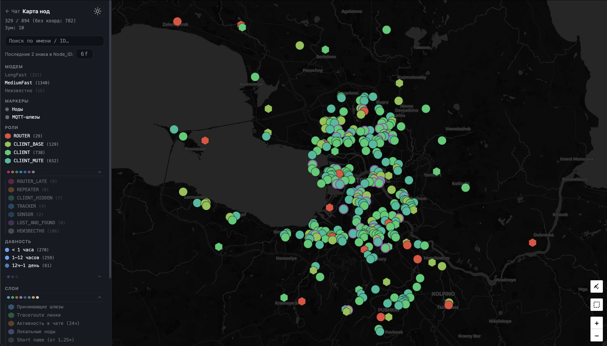
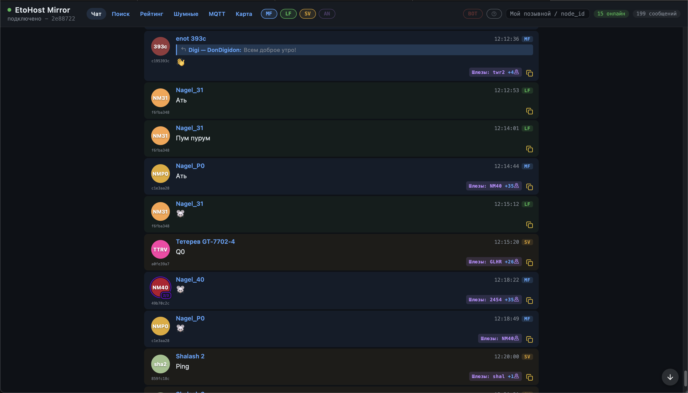
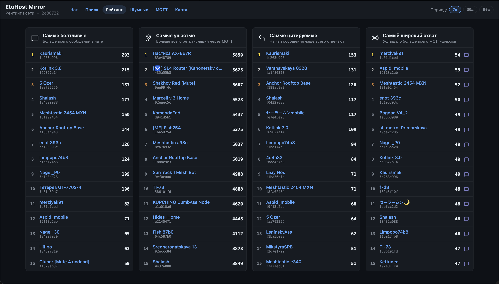
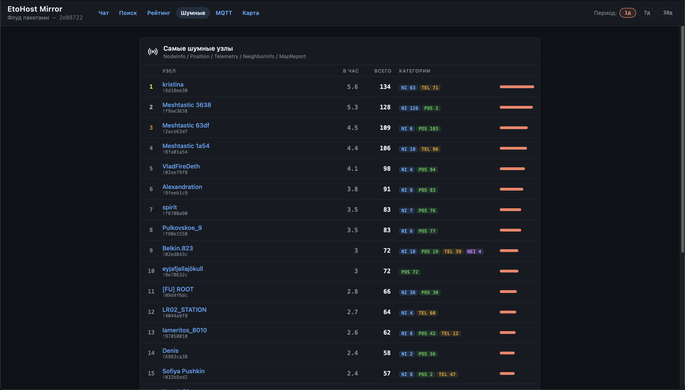
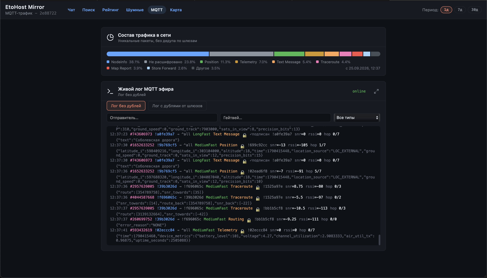
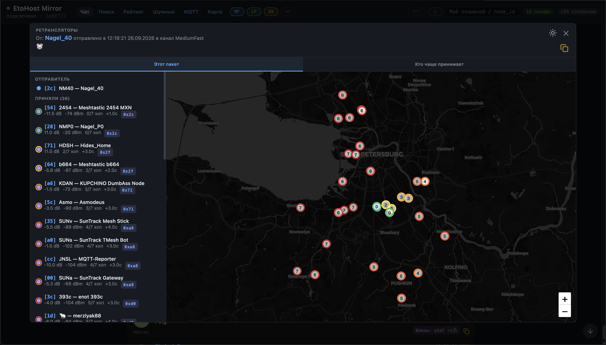

# OneMesh Mirror


Веб-платформа для мониторинга LoRa mesh-сети [Meshtastic](https://meshtastic.org/) и набор сервисов для клиента [Meshex](https://meshex.ru). Проект развивается для сети **OneMesh** в Санкт-Петербурге и области (MQTT-топики `msh/RU/SPB/#`).

Проект слушает трафик mesh-сети через MQTT, декодирует protobuf-пакеты Meshtastic, сохраняет данные и показывает их в реальном времени: карта узлов, чат с историей, приёмы шлюзов, лидерборды и traceroute-графы. Публичное API позволяет подключать сторонние интеграции.

В состав платформы также входят сервис изображений, сервер диагностических отчётов и объявлений, источники стикеров и веб-админка каталога. Сервисы **Image, Report и Sticker** реализуют интеграцию зеркала с клиентом **[Meshex](https://meshex.ru)** для сетей Meshtastic. Клиент узнаёт доступные сервисы из capabilities выбранного зеркала. Отдельный бот обслуживает служебный канал сети, отвечая на команды по радио и через WebSocket-фид зеркала.

> Исходный код готовится к открытой публикации в этом репозитории. Пока здесь доступны описание проекта, скриншоты и ссылка на рабочее демо.

## Демо

**[🌐 mirror.etohost.ru](https://mirror.etohost.ru)** — рабочий инстанс, живые данные сети OneMesh SPB.

Ниже описаны возможности проекта в целом. Доступность дополнительных сервисов зависит от настроек экземпляра и развёрнутой версии; новые функции сначала проверяются на дев-стенде. Описание будет дополняться по мере подготовки исходного кода к публикации.

## Скриншоты

| Карта узлов | Живой чат |
|---|---|
|  |  |

| Лидерборд | Антирейтинг |
|---|---|
|  |  |

| MQTT-лог | Шлюзы |
|---|---|
|  |  |

---

## Состав проекта

| Компонент | Назначение |
|---|---|
| **Зеркало сети** | Backend (FastAPI) + Frontend (Vue 3 SPA) — приём MQTT-трафика сети, хранение данных, REST/WebSocket API, веб-интерфейс мониторинга |
| **mesh-bot** | Сервисный бот, работающий на служебном канале mesh-сети: отвечает на команды по радио и через WebSocket-фид зеркала |
| **images** | Необязательный сервис загрузки и раздачи изображений для чата, с ограниченным сроком хранения и инструментами модерации |
| **reports** | Необязательный сервер диагностических отчётов клиента, объявлений и статистики скачиваний |
| **stickers** | Источник каталогов и неизменяемых ревизий стикерных наборов, инструменты публикации и веб-админка |

Дополнительные сервисы входят в состав платформы. Сервис изображений, сервер отчётов и отдельный сервер источника стикеров включаются Docker Compose-профилями; для источника стикеров также доступна раздача через web-сервис зеркала. Основное зеркало работает без этих контейнеров. Источник стикеров может обслуживаться отдельно от зеркала или находиться у другого оператора.

---

## Зеркало сети

### Функциональность

- Приём и декодирование пакетов Meshtastic (protobuf) из MQTT-трафика сети
- Хранение узлов, сообщений, телеметрии, traceroute-цепочек, координат и истории позиций
- Живой чат по каналам сети с историей, ответами, реакциями и realtime-обновлениями
- Счётчик уникальных шлюзов, принявших сообщение, и карта приёмов по нажатию на него
- Отображение изображений по ссылкам и стикеров с подгрузкой проверенных файлов
- Интерактивная карта узлов (Leaflet)
- Лидерборды и антилидерборды активности
- Визуализация traceroute-связей между узлами (relay graph)
- Панель live-просмотра сырого MQTT-трафика (для отладки/аналитики)
- Админ-панель: фильтры нод и сообщений, рамки аватарок, правила версий клиента, управление каталогом стикеров
- Обнаружение дополнительных сервисов через `GET /api/v1/capabilities`: адреса, параметры и поддерживаемые версии задаются оператором экземпляра
- Публичное партнёрское REST API (`/integration`) с версионированным, зафиксированным контрактом
- Полное протоколирование трафика сети в ClickHouse для аналитики (опционально, отдельно от основного пайплайна)

### Изображения, отчёты и стикеры

Эти модули обеспечивают интеграцию с клиентом [Meshex](https://meshex.ru): Image — изображения в чате, Report — диагностические отчёты и объявления, Sticker — каталоги и обмен стикерами.

Клиент Meshex: [сайт](https://meshex.ru) · [GitHub](https://github.com/suntrackspb/Meshex).

**Изображения (`images`)**

Клиент загружает изображение в отдельный HTTP-сервис, а в радиосообщение отправляет короткую ссылку. Сами изображения по LoRa не передаются.

- Проверка подписи загрузки с использованием ключа ноды; лимиты на загрузки и обращения
- Перекодирование в WebP с удалением исходных метаданных
- Хранение файлов в S3-совместимом хранилище (например, Garage) или на диске; служебные сведения — в SQLite
- Автоматическое удаление по сроку хранения; по умолчанию — через 72 часа
- Удаление своей картинки по токену, жалобы, баны и административная модерация

**Отчёты и объявления (`reports`)**

Пользователь может явно отправить из клиента диагностический журнал, сведения о приложении и устройстве, комментарий и контакт. Сервер выдаёт номер отчёта, по которому оператор находит материалы.

- Приём сжатых журналов с ограничениями размера и частоты отправки
- Веб-админка для поиска отчётов, просмотра и скачивания журналов
- Объявления для пользователей клиента: уровни важности, срок действия, фильтры по версии и платформе
- Статистика скачиваний сборок приложения

**Стикеры (`stickers`)**

В радиопакете передаются URL источника, SHA-256 манифеста набора и ID стикера. Картинки клиент и веб-чат скачивают по HTTPS из соответствующего источника.

- Descriptor источника, каталог наборов и неизменяемые ревизии с проверкой хешей манифеста и файлов
- Статичные и анимированные WebP, PNG-превью для анимаций
- Сохранение стикера как сообщения в PostgreSQL: история, поиск, контекст, ответы и WS/SSE используют структурированное содержимое
- Один пакет от нескольких шлюзов создаёт одно сообщение; уникальные приёмы дополняют его счётчик и карту, как у текста
- Веб-админка: выбор файлов или папки подготовленных WebP, предпросмотр, проверка лимитов, генерация превью, публикация и снятие набора с публикации
- Ошибки отдельных файлов показываются до публикации; публикация подходящей части требует явного подтверждения
- Источники, объявленные зеркалом, могут загружаться автоматически для видимых сообщений; неизвестные источники требуют согласия посетителя
- MQTT-обработчик сохраняет ссылку на стикер без сетевого запроса к источнику. Недоступность картинки не удаляет сообщение и историю его приёмов

Исходные наборы, загруженные изображения, отчёты и данные экземпляра хранятся отдельно от кода и не включаются в этот публичный репозиторий.

### Технологический стек

**Backend**

- Python 3.12 в Docker; локальная разработка также на Python 3.14
- FastAPI, Uvicorn
- asyncpg и явный SQL для основного data-access; Alembic / SQLAlchemy и psycopg2 — для миграций
- PostgreSQL 16 — основное хранилище
- Redis 7 — кэш и pub/sub для realtime-рассылки
- ClickHouse — хранилище полного MQTT-трафика для аналитики
- paho-mqtt — MQTT-подключение в отдельном потоке, обработка через asyncio.Queue
- protobuf, локально собранные протобафы Meshtastic (актуальнее пакета `meshtastic` из PyPI)
- pydantic-settings — типизированная конфигурация
- Pillow — проверка изображений и подготовка стикерных превью
- SQLite и S3-совместимое хранилище — данные дополнительных сервисов
- pytest / pytest-asyncio — тесты, включая контрактные тесты API

**Frontend**

- Vue 3 (TypeScript) + Vite
- Pinia — управление состоянием
- Vue Router
- Leaflet — карта узлов
- `@lucide/vue` — иконки
- `openapi-typescript` — генерация типов API из OpenAPI-схемы backend'а
- Vitest — юнит-тесты
- Два независимых сборочных таргета: realtime-транспорт на WebSocket или Server-Sent Events (для деплоя за прокси без поддержки WS)

**Инфраструктура**

- Docker / Docker Compose: backend, MQTT-listener-ы и миграции; необязательные профили `images`, `reports`, `stickers`, `clickhouse` и `tmesh`
- nginx — раздача SPA и реверс-прокси перед API
- GitHub Actions — CI/CD

### Архитектура

```
Внешний MQTT-брокер (msh/RU/SPB/#)
        │
        ▼
mqtt-listener(-ы)  →  декодирование protobuf  →  обработчики по типу пакета
        │                                              │
        ▼                                              ▼
   PostgreSQL                                    ClickHouse (аналитика)
   (узлы, текст и стикерные сообщения, relays, телеметрия, traceroute...)
        │
        ▼
   Redis pub/sub (realtime-шина)
        │
        ▼
FastAPI web-сервис
  - REST-роутеры (чат, узлы, лидерборды, traceroute, админка...)
  - отдельное публичное integration API (Bearer-auth, зафиксированный контракт)
  - WebSocket / SSE: начальная история и новые события из Redis
  - capabilities и HTTP-раздача собственного источника стикеров
  - раздача собранного Vue SPA
        │
        ▼
Vue 3 SPA — карта, чат, лидерборды, админка, typed API-клиент

Клиент Meshex (meshex.ru)
  ├─ capabilities зеркала → доступные сервисы и источники
  ├─ images → HTTP-загрузка картинки → короткая ссылка в радио
  ├─ reports → диагностический отчёт по действию пользователя
  └─ stickers → HTTPS-каталог и файлы → ссылка на стикер в радио

Изображения и стикерные файлы не передаются внутри радиопакетов.
```

### Паттерны и подходы

- **Слоистая архитектура backend**: чёткое разделение data-access (`db/`), бизнес-логики (`services/`), HTTP-слоя (`web/routers/`) и слоя приёма данных (`mqtt/handlers/`)
- **Реестр обработчиков** для диспетчеризации MQTT-пакетов по типу порта
- **Типобезопасность фронтенда** через автогенерацию TypeScript-типов из OpenAPI-схемы backend'а
- **Realtime fan-out через Redis pub/sub** вместо прямого polling
- **Двойная сборка фронтенда** (WebSocket / SSE) из единой кодовой базы через абстракцию транспорта
- **Alembic-миграции** для обновления схемы PostgreSQL с сохранением истории сообщений
- **Общий pipeline текста и стикеров**: сохранение сообщения, дедупликация, накопление приёмов шлюзов и realtime-рассылка
- **Независимые дополнительные сервисы** и объявление их возможностей через capabilities
- **Декоратор устойчивости кэша** — единая точка обработки сбоев Redis без дублирования try/except

---

## mesh-bot

### Функциональность

Сервисный бот, работающий на выделенном канале mesh-сети. Отвечает на команды пользователей как принятые напрямую по радио (через подключённый Meshtastic-узел), так и присланные через WebSocket-фид зеркала (для пользователей вне зоны радиоприёма). Ответы всегда отправляются по радио, чтобы их подхватили MQTT-шлюзы и mirror.

Команды: прогноз погоды, курсы валют, ping, информация об узле, лидерборд, время восхода/заката, ранг пользователя, статистика сообщений, модерация, справка и др.

### Технологический стек

- Python, библиотека `meshtastic` — коммуникация с радио-узлом
- `websockets` — подключение к realtime-фиду зеркала
- `asyncpg` — доступ к PostgreSQL
- `aiohttp` / `requests` — обращения к внешним API (погода, курсы валют)
- systemd — деплой как системный сервис с watchdog/heartbeat

### Архитектура и подходы

- **Два независимых транспорта команд**: прямой радио-канал (serial/TCP/`meshtasticd`) и WebSocket-подписка на mirror, объединённые единым диспетчером команд
- **Реестр команд через декоратор** (`@command(...)`) — новая команда добавляется файлом и одной строкой импорта
- **Outbox-паттерн** — исходящие ответы ставятся в очередь с ретраями и rate-limiting, отвязывая обработчики команд от деталей транспорта
- **Watchdog / systemd heartbeat** для отказоустойчивости сервиса

---

## Статус

Проект в активной разработке и эксплуатации, обслуживает реальную mesh-сеть OneMesh. Дополнительные сервисы и их интеграция с мобильным клиентом развиваются поэтапно; наличие функции в коде не означает, что она уже включена на всех экземплярах.

Исходный код будет опубликован в этом репозитории после завершения подготовки: очистки секретов, подготовки примеров конфигурации и проверки документации. Пользовательские файлы, диагностические отчёты и сторонние стикерные наборы в публикацию исходников не входят.
